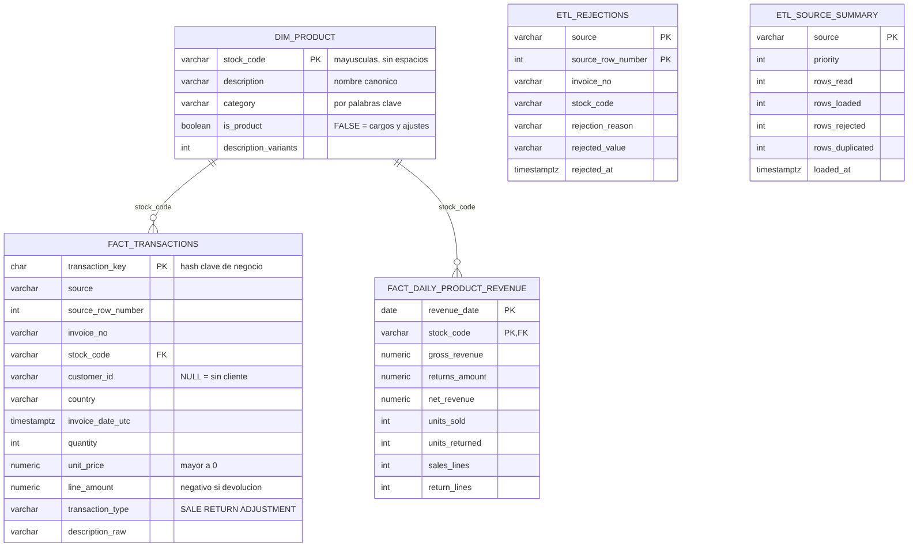
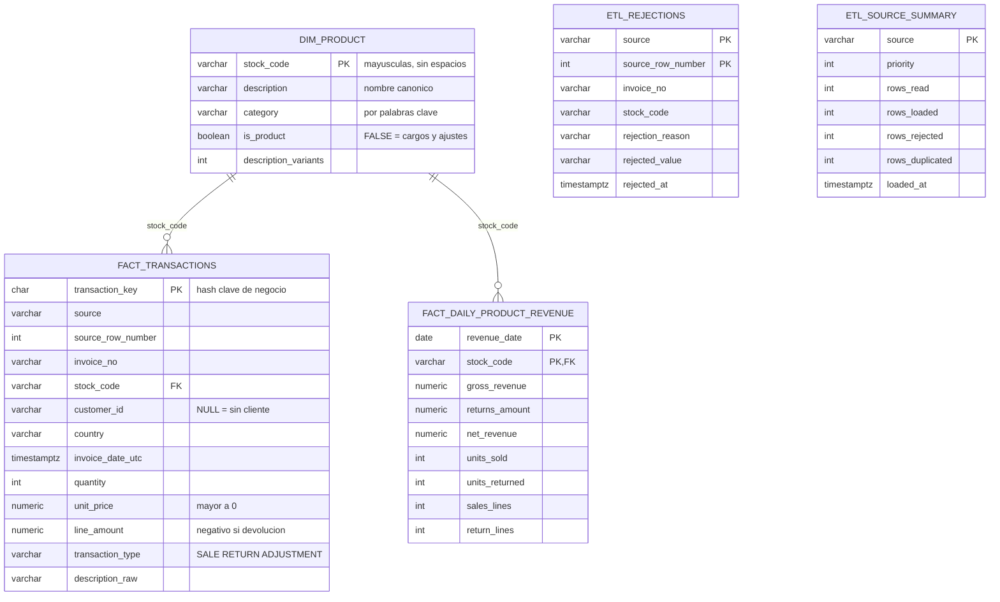

# Diagrama del modelo de datos

Fuente editable del diagrama: [`modelo.mmd`](modelo.mmd) (Mermaid). GitHub también lo muestra directamente:

## Tablas

| Tabla | Tipo | Grano (1 fila = …) | Para qué sirve |
|---|---|---|---|
| `dim_product` | Dimensión | un código de producto | Nombre canónico, categoría y si es producto real o un cargo |
| `fact_transactions` | Hecho | una línea de factura | Detalle de ventas **y** devoluciones (`transaction_type`) |
| `fact_daily_product_revenue` | Hecho agregado | un producto en un día (UTC) | Revenue bruto, devoluciones y **neto** (regla de negocio) |
| `etl_rejections` | Auditoría | una fila rechazada | Motivo, valor rechazado y fuente de origen |
| `etl_source_summary` | Auditoría | una fuente | Filas leídas, cargadas, rechazadas y duplicadas en la última carga |

## Relaciones

- `fact_transactions.stock_code` → `dim_product.stock_code` (llave foránea real).
- `fact_daily_product_revenue.stock_code` → `dim_product.stock_code` (llave foránea real).
- Las tablas `etl_*` no se relacionan con las demás a propósito: guardan datos que **no** entraron al modelo.
